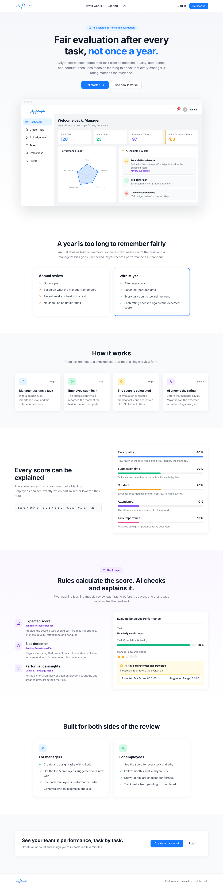
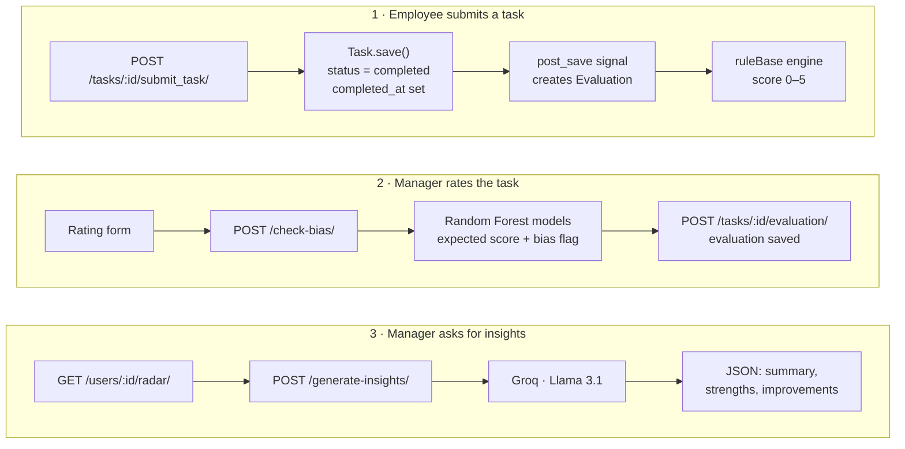

# Miyar (معيار) — Per-Task Performance Evaluation with AI

**Miyar** is a Django REST API for employee performance evaluation that scores each employee **after every task** instead of once a year. When an employee submits a task, the backend automatically creates an evaluation and calculates a 0–5 score using clear, explainable rules. Two machine learning models then check whether the manager's rating matches the evidence, and a language model turns the metrics into written feedback.

**Live demo:** [miyar.pythonanywhere.com](https://miyar.pythonanywhere.com) · **API docs:** [/api/docs/](https://miyar.pythonanywhere.com/api/docs/)

> Demo manager account: `manager_2025` / `123456`. The demo data (200 employees and a year of tasks) is synthetic.

> **About this repository:** this is a public showcase of Miyar. It contains the documentation and a selection of the backend and AI code. The full source code is in a private repository and is available on request.



---

## Table of contents

- [The problem](#the-problem)
- [Features](#features)
- [How it works](#how-it-works)
- [The scoring engine](#the-scoring-engine)
- [The AI layer](#the-ai-layer)
- [API reference](#api-reference)
- [Tech stack](#tech-stack)
- [Code samples](#code-samples)
- [Deployment](#deployment)
- [Limitations and roadmap](#limitations-and-roadmap)

---

## The problem

Annual performance reviews rely on what a manager remembers from twelve months of work. The most recent weeks count the most, and nothing checks whether a rating is fair.

Miyar records performance as it happens:

| Annual review | With Miyar |
| --- | --- |
| Once a year | After every task |
| Based on memory | Based on recorded data (deadline, quality, attendance, conduct) |
| Recent weeks outweigh the rest | Every task counts toward the trend |
| No check on an unfair rating | Each rating is compared with an expected score |

---

## Features

**Evaluation and scoring**
- An evaluation is created automatically when a task is submitted (Django `post_save` signal).
- A rule-based engine calculates a 0–5 score from five weighted factors.
- Monthly and yearly performance summaries, plus a monthly score trend.
- A five-axis performance radar per employee.

**AI**
- **Expected score:** a Random Forest regressor predicts the score a task should receive, with a suggested range.
- **Bias detection:** a Random Forest classifier flags a manager rating that doesn't match the evidence.
- **Performance insights:** Llama 3.1 (via the Groq API) writes a summary of strengths and areas to improve, returned as structured JSON.
- **Smart task assignment:** ranks the top 5 employees for a new task by quality and on-time delivery, weighted by the task's importance.

**Platform**
- JWT authentication with two roles: `manager` and `employee`.
- Role-based permissions, and querysets filtered so employees only see their own data.
- Business logic kept in a service layer, separate from the views.
- OpenAPI schema and Swagger UI generated with drf-spectacular.
- Docker Compose setup for the backend and frontend.

---

## How it works



The key design decision: **scores always come from deterministic rules. The AI only checks and explains them.** A model error or an LLM hallucination can never change anyone's score.

---

## The scoring engine

The engine lives in `backend/core/services/scoring.py` (class `ruleBase`) and is called from `Evaluation.calculate_final_score()`. Each factor is scored out of 100, then combined with fixed weights:

| Factor | Weight | How it is scored (0–100) |
| --- | --- | --- |
| Task quality | 40% | Manager-entered completion ratio × 100 |
| Submission time | 20% | On time = 100 · up to 24 h late = 90 · 2–4 days late = −15 per extra day · later = 0 |
| Conduct (breaches) | 20% | None = 100 · Low = 80 · Moderate = 50 · High = 0 |
| Attendance | 10% | Attendance score for the period (default 100) |
| Task importance | 10% | Lateness and quality deductions are multiplied by 1.5 for high-importance tasks, 1.0 for medium, 0.5 for low |

```
final score = (0.4·Quality + 0.2·Submission + 0.2·Conduct + 0.1·Attendance + 0.1·Importance) / 20
```

Because the rules are explicit, an employee can see exactly why they received, for example, 3.8 instead of 4.5.

---

## The AI layer

### 1. Expected score and bias detection (scikit-learn)

| Model | Algorithm | Features | Target |
| --- | --- | --- | --- |
| Expected score | `RandomForestRegressor` (100 trees) | task importance, days late, quality, attendance, breach level | Expected score (0–100) |
| Bias detection | `RandomForestClassifier` (100 trees) | the five above + manager's star rating | `is_biased` (0 or 1) |

**Serving:** both models are saved as `.pkl` files in `backend/ml_models/` and loaded once with `joblib` when Django starts. `bias_service.analyze_evaluation()` runs both models and returns:

```json
{
  "is_biased": true,
  "expected_score": 86,
  "suggested_range": "82-90",
  "recommendation": "Please justify or revise the evaluation. Suggested range: 82-90."
}
```

A rating is flagged when the classifier predicts bias **or** the gap between the manager's rating (stars × 20) and the expected score is greater than 15 points. The flag asks the manager for a second look; it never changes the rating.

**Training pipeline** (`backend/ml_pipeline/`):

1. `seed_data.py` generates 200 employees and a full year of tasks, attendance, breaches and evaluations with Faker.
2. `export_ml_data.py` exports one CSV row per evaluation.
3. `train_regressor_model.py` builds the labels, balances the two classes, runs **5-fold cross-validation**, prints a classification report on a held-out 20% split, and saves both models.
4. `check_accuracy.py` prints R², MAE and accuracy for the saved models.

`train_bias_model.py` deliberately removes `rule_base_score` and the score difference from the features to avoid **data leakage**, so the model can't simply read the answer from its inputs.

> **Note on the data:** the training data is **synthetic**. No real HR data was available, so the labels are produced by a formula. The pipeline is complete and ready to be retrained on real, manager-validated ratings. See [Limitations and roadmap](#limitations-and-roadmap).

### 2. Performance insights (LLM)

`POST /api/generate-insights/` sends an employee's radar metrics and completion rate to **Llama 3.1 8B Instant** on Groq:

- The prompt asks for **only** a JSON object with `summary`, `strengths` and `areas_for_improvement`.
- `temperature=0.2` keeps answers consistent and close to the numbers.
- Markdown code fences are stripped before `json.loads()`, with a fallback to the raw text if parsing fails.
- The API key is read from the `GROQ_API_KEY` environment variable, never from code.

---

## API reference

All endpoints are under `/api/` and, except registration and login, require `Authorization: Bearer <access token>`. Interactive documentation is available at **`/api/docs/`** (Swagger UI).

| Method | Endpoint | Who | Description |
| --- | --- | --- | --- |
| POST | `/api/register/` | Anyone | Create an employee account |
| POST | `/api/token/` | Anyone | Log in, returns access and refresh tokens |
| POST | `/api/token/refresh/` | Anyone | Get a new access token |
| GET | `/api/me/` | Logged in | Current user's id, username and role |
| GET, POST | `/api/tasks/` | POST: manager | List tasks (employees see their own) / create a task |
| GET, PUT, PATCH, DELETE | `/api/tasks/:id/` | Logged in | Task details and updates |
| POST | `/api/tasks/:id/start_task/` | Assigned employee | Move a task from pending to in progress |
| POST | `/api/tasks/:id/submit_task/` | Assigned employee | Submit a task, which triggers the evaluation |
| GET, POST | `/api/tasks/:id/evaluation/` | POST: manager | View or save a task's evaluation |
| GET, POST, PATCH, DELETE | `/api/evaluations/` | Writes: manager | Evaluations, filterable by `task`, `date_from`, `date_to` |
| GET | `/api/my-tasks/` | Logged in | Current user's tasks |
| GET | `/api/my-evaluations/` | Logged in | Current user's evaluations |
| GET | `/api/dashboard-summary/` | Logged in | Task counts, completion rate, average score |
| GET | `/api/performance-summary/` | Logged in | Monthly and yearly scores and the monthly trend |
| GET | `/api/users/:id/radar/` | Logged in | Five-axis performance radar |
| GET | `/api/employees/` | Logged in | List of employees |
| POST | `/api/check-bias/` | Logged in | Expected score and bias check for a rating |
| POST | `/api/generate-insights/` | Logged in | LLM-written performance summary |
| POST | `/api/smart-assign/` | Manager | Top 5 recommended employees for a task |

**Example: checking a rating for bias**

```http
POST /api/check-bias/
Authorization: Bearer <token>
Content-Type: application/json

{
  "task_importance": 3,
  "days_late": 0,
  "quality_score": 92,
  "attendance_score": 100,
  "breach_level": 0,
  "manager_stars_score": 2
}
```

---

## Tech stack

| Area | Tools |
| --- | --- |
| Backend | Python 3.10, Django 5.2, Django REST Framework, SimpleJWT, django-filter |
| AI / ML | scikit-learn (Random Forest), pandas, NumPy, joblib, Groq API (Llama 3.1) |
| API docs | drf-spectacular (OpenAPI 3, Swagger UI) |
| Testing | Django `TestCase`, DRF `APITestCase` |
| Frontend | React 19, TypeScript, Vite, Ant Design, Recharts |
| DevOps | Docker, Docker Compose, GitHub Actions, PythonAnywhere |

---

## Code samples

The [`code-samples/`](code-samples/) folder holds the parts of the backend that carry the main ideas:

| File | What it shows |
| --- | --- |
| [`scoring.py`](code-samples/scoring.py) | The rule-based scoring engine (`ruleBase`): five weighted factors and the importance multiplier |
| [`models.py`](code-samples/models.py) | Data models, `Evaluation.calculate_final_score()`, and the `post_save` signal that creates an evaluation when a task is submitted |
| [`bias_service.py`](code-samples/bias_service.py) | Serving both Random Forest models: expected score, suggested range and bias flag |
| [`train_models.py`](code-samples/train_models.py) | Training pipeline (`ml_pipeline/train_regressor_model.py` in the full project): label building, class balancing, 5-fold cross-validation, saving the models |
| [`ai_views.py`](code-samples/ai_views.py) | The two AI endpoints: bias check and LLM performance insights (Groq, Llama 3.1) |
| [`permissions.py`](code-samples/permissions.py) | Custom DRF permissions for the manager and employee roles |
| [`test_scoring_engine.py`](code-samples/test_scoring_engine.py) | Unit tests for the scoring engine, from the full suite of 71 tests |

These files are excerpts and won't run on their own; they import other parts of the project.

---

## Deployment

The live demo runs on **PythonAnywhere** (free plan), with Django serving both the API and the built React app from one domain.

**How it is wired**
- `npm run build` produces `frontend/dist/`. Django renders `dist/index.html` for every path that isn't `/api/`, `/admin/` or a static file (a `TemplateView` catch-all in `backend/urls.py`), so React Router handles `/`, `/login` and the app pages.
- PythonAnywhere serves the static files directly:

| URL | Directory |
| --- | --- |
| `/static/` | `backend/staticfiles` (after `collectstatic`) |
| `/assets/` | `frontend/dist/assets` |

- Secrets (`DJANGO_SECRET_KEY`, `GROQ_API_KEY`) live in `backend/.env` on the server, not in the repository.

**Two lessons from deploying**
1. **Disk quota.** The free plan allows 512 MB, and NumPy, SciPy, pandas and scikit-learn alone come close to that. The virtualenv was created with `--system-site-packages` to reuse the scientific libraries PythonAnywhere already provides, and only the remaining packages were installed.
2. **Model compatibility.** A pickled scikit-learn model depends on the library versions it was saved with. The models trained locally (scikit-learn 1.7.2, NumPy 2) could not be loaded on the server (scikit-learn 1.5.1, NumPy 1.21), so they were retrained on the server with `train_regressor_model.py`. The fixed `random_state=42` keeps the results reproducible.

---

## Limitations and roadmap

Miyar is a prototype I built on my own, as a solo project. These are the known limitations and what I would change for production:

**Machine learning**
- **Synthetic labels.** The expected score and the bias label are produced by formulas, so the models mainly learn those formulas back. The next step is training on real ratings reviewed by HR, or on outcomes such as appeals.
- **One source of truth.** The training formula differs from the scoring engine's weights. Training labels should be generated by calling `ruleBase` directly.
- **Better bias signals.** A fixed gap rule can't detect patterns such as one manager consistently rating lower than peers on similar tasks. That is where a model adds real value.
- **Fairness audit.** Check the flags for disparate impact across groups. Gender is stored but is never used as a model feature.
- **Pinned ML versions.** Train and serve with the same library versions (or export the models to a version-independent format) instead of retraining on each server.

**Backend**
- Restrict task updates and deletion to managers, and limit the radar endpoint to the employee's own data.
- Keep `completed_at` when a task moves to the `evaluated` status.
- Fix N+1 queries in the radar and smart-assignment views with aggregation.
- Run LLM calls in a background queue (Celery) with timeouts, retries and schema validation.

**Deployment**
- Shorten JWT lifetimes, and restrict `ALLOWED_HOSTS` and CORS to the real domain.
- Use PostgreSQL and Gunicorn instead of SQLite and the development server.

---

## Author

**Mashael Alharbi** · [GitHub @Mashael16](https://github.com/Mashael16)
